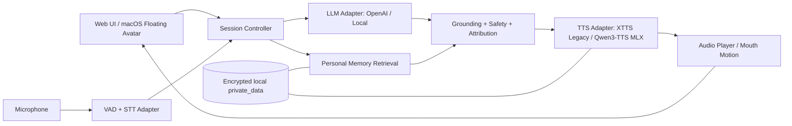

# DigitalMe — 系統架構 2026

## 1. 設計原則
可獨立測試、可替換、Local-first、清楚劃分人類真實紀錄和 AI 生成內容、觀測每個階段的時間與來源。



## 2. Adapter 契約
```python
from typing import Protocol, AsyncIterator

class ASRBackend(Protocol):
    async def transcribe(self, audio_bytes: bytes, language: str = "zh") -> str: ...

class ChatBackend(Protocol):
    async def reply(self, messages: list[dict], evidence: list[dict]) -> str: ...

class TTSBackend(Protocol):
    async def synthesize(self, text: str, voice_id: str) -> bytes: ...  # WAV/PCM

class AvatarBackend(Protocol):
    async def speak(self, audio_bytes: bytes, text: str) -> None: ...
```
實作需另外定義音訊 sample rate / codec、取消與中斷、timeout、error codes、speaker reference ownership 與模型版本。所有供應商 SDK 僅存在 adapter 內。

## 3. 推薦首版堆疊
- **Frontend**：TypeScript + React + Vite，先做瀏覽器 UI；具麥克風錄音、文字輸入、逐字稿、播放、Avatar overlay、引擎切換、來源提示。
- **Backend**：Python FastAPI；REST 開發 API，後續改用 WebSocket / SSE 串流事件。
- **STT**：可替換本地 Whisper 引擎；開發期可用手動輸入做 deterministic E2E。
- **LLM**：OpenAI API text dialogue adapter + mock provider；可增加本地 LM Studio / OpenAI-compatible API。
- **TTS**：保留現有已運作的 XTTS Python 3.11 環境作 legacy adapter；**新模型須獨立環境或程序**，候選 Qwen3-TTS MLX。
- **Avatar P0**：一張本人授權、僅在本機的照片 + CSS/Canvas 嘴部開合、眨眼、音量驅動；**音量≠真實音素嘴型**，不宣稱精確對嘴。
- **Avatar P1/P2**：研究 viseme/phoneme alignment、LivePortrait 及其他 talking-head 模型，先離線比較再評估即時性能。
- **Desktop**：P1 採 Tauri 透明 window / always-on-top / drag；macOS 權限、click-through、音訊焦點需實機測試，或採 Swift 原生覆蓋層。

## 4. 建議的 repo 結構（未實作，Agent 建立）
```text
DigitalMe/
├── README.md
├── AGENTS.md
├── docs/
│   ├── ORIGINAL_REQUIREMENTS.md
│   ├── ARCHITECTURE_2026.md
│   ├── TECH_RESEARCH_2026.md
│   ├── ROADMAP_ACCEPTANCE.md
│   ├── INTERFACE_CONTRACTS.md
│   └── WORK_HANDOFF.md
├── apps/
│   ├── web/                 # React / Vite UI
│   └── desktop/             # optional Tauri wrapper
├── services/
│   ├── api/                 # FastAPI + orchestration
│   ├── tts_xtts_legacy/     # isolated environment
│   ├── tts_mlx/             # new models isolated
│   └── stt/
├── packages/
│   └── contracts/           # shared API schemas
├── tests/
│   ├── unit/
│   ├── integration/
│   └── e2e/
├── scripts/
├── evidence/                # non-sensitive sanitized test artefacts
└── private_data/            # never commit
```

## 5. 回應與資料來源
每個 assistant turn 保留 `turn_id, session_id, text, voice_backend, llm_backend, evidence_refs, generated_at, disclosure_type`。如果回答來自本人留存的原聲，使用 `authentic_recording`；若由 LLM 與 TTS 產生，必標為 `ai_generated`。沒有個人資料時，不假造第一人稱「記得」。

## 6. Stream / Latency
- P0：錄音結束後開始處理，逐段 / 整句播放。避免在第一版引入全雙工與多人同時說話。
- P1：VAD、partial transcripts、streaming LLM、分句 TTS 和可中斷播放；記錄 mic-end→first-audio、LLM、STT、TTS 各段耗時。
- P2：視聽連動、barge-in、全雙工、Mobile。
- 開發期間所有服務先綁 `127.0.0.1`，要跨裝置先做好 TLS 與授權；不要直接公開未認證 TTS / speaker API。
